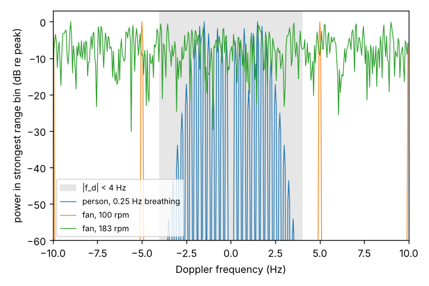

# mmwave-presence

Presence sensing through a wall with a 60 GHz FMCW radar: detect people from
their breathing and tell them apart from pets and ceiling fans.

The project is simulation based. So far there is an IF signal simulator for
point targets, the range FFT, the Doppler FFT over slow time, and a crude
presence check (motion energy after static clutter removal, against a fixed
threshold) run on four scenes: an empty room, a breathing person, a
breathing pet and a ceiling fan. The energy check passes a pet as a person
whenever the pet is close enough to be seen, which is the case the
classifier has to handle. Without noise, a ceiling fan spreads evenly over
the whole +-10 Hz Doppler span while breathing stays below about 4 Hz.
Taking that flat floor off the power below 4 Hz cuts the fan false alarms
from 17 to 0 in 100 at the 1.0 noise level, for 46 people detected against
51 with the energy check.



The fans left over the excess threshold at low noise are the near, strong ones:
at most speeds the fan's spectrum looks like noise (183 rpm above), and
only when the blade-pass rate divides the 20 Hz frame rate does it fold
into a few clean lines (100 rpm).
Dividing the excess by its own scatter in the empty room
(`low_band_score`) clears those fans too (34 -> 0 in 100 at noise 0.1),
and its empty-room threshold stays the same at every noise level. It
detects fewer people when the noise is high (41 against 46 at 1.0);
NOTES.md has the table. Setting the thresholds from the 99th percentile
of 1000 empty windows, rather than the largest of 100, gets back only
two of those people (43 at 1.0), so the gap is in the score's empty-room
tail and not in how few windows set the threshold. That tail comes from
the max over range picking bins whose floor spread came out low by chance.
With the spread raised to the median of the 8 range bins either side
(`--pool 8`) the score detects 49 people at noise 1.0, the same as the
excess, and still lets no fan through at any noise level.

```
pip install -e .[dev]
pytest
python experiments/energy_threshold.py    # about 40 s
python experiments/doppler_spread.py      # about 10 s
python experiments/low_band.py            # about 70 s
python experiments/low_band.py --empty 1000 --quantile 0.99   # about 2 min
python experiments/low_band.py --empty 1000 --quantile 0.99 --pool 8
python experiments/fan_spectrum.py        # about 15 s, writes figures/
```

Results so far are in NOTES.md.
